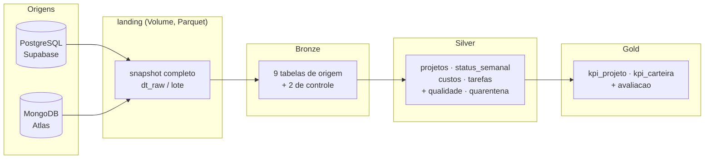
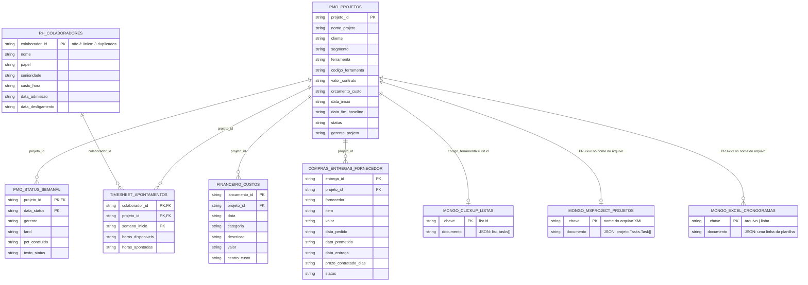
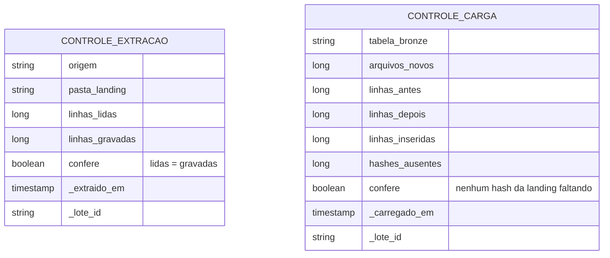
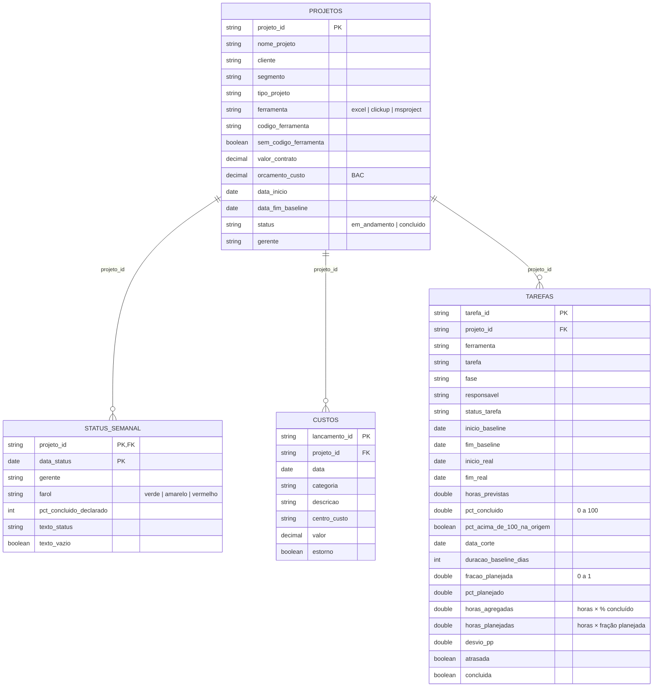
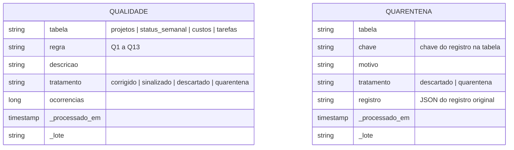
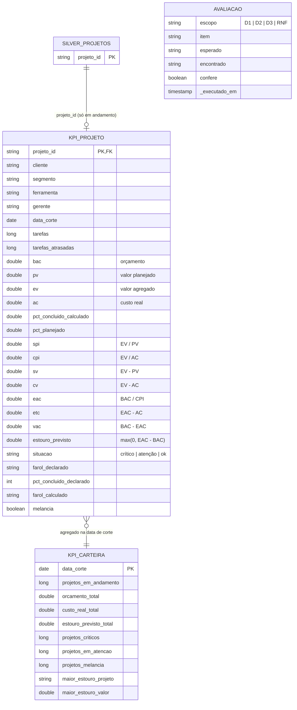

# Modelo de dados por camada

Diagramas entidade-relacionamento de cada camada do lakehouse, gerados a partir do `information_schema` do Unity Catalog (catálogo `workspace`). Os diagramas usam [Mermaid](https://mermaid.js.org/), que o GitHub renderiza; no visualizador de Markdown do Databricks eles aparecem como texto.

Convenções:
- Colunas começando com `_` são **metadados técnicos** (rastreio, idempotência, auditoria), não dados de negócio.
- Os relacionamentos são **lógicos**: o Delta não impõe chave estrangeira. A integridade é verificada pelo pipeline (quarentena na silver e avaliação na gold).
- Na landing e na bronze, todas as colunas de negócio do Postgres são `string`, como vieram da origem; a tipagem acontece na silver.

## Visão geral

---

## Landing (`/Volumes/workspace/raw/landing`)

Arquivos Parquet imutáveis, um diretório por origem e por snapshot: `<fonte>/<tabela>/dt_raw=AAAA-MM-DD/lote_<id>/part-*.parquet`. Cada arquivo tem as colunas da origem mais quatro colunas técnicas acrescentadas na extração.

| Coluna técnica | Tipo | Significado |
|---|---|---|
| `_hash` | string | SHA-256 do conteúdo da linha (no Mongo, do documento sem `_id` e `_carregado_em`) |
| `_chave` | string | chave natural do registro (ver [chaves-idempotencia.md](https://github.com/lauroPereira/pmo-lakehouse/blob/main/docs/chaves-idempotencia.md)) |
| `_extraido_em` | timestamp | instante da extração (desempata snapshots do mesmo dia) |
| `_lote_id` | string | identificador do snapshot |
| `dt_raw` | date | partição do diretório: data da extração |

O modelo lógico da landing é o modelo da origem:

---

## Bronze (`workspace.bronze`)

Mesmas entidades e relacionamentos da landing, com o nome `pg_<schema>_<tabela>` ou `mongo_<coleção>`, as colunas de negócio idênticas (`string`) e os metadados abaixo em todas as tabelas. Guarda **versões**: linha alterada na origem entra como linha nova; a versão vigente é a de `_extraido_em` mais recente por `_chave`.

| Coluna técnica | Tipo | Origem |
|---|---|---|
| `_hash`, `_chave`, `_extraido_em`, `_lote_id`, `dt_raw` | — | vêm da landing |
| `_arquivo` | string | Parquet que originou a linha (`_metadata.file_path` do Auto Loader) |
| `_carregado_em` | timestamp | instante da carga na bronze |
| `_origem` | string | nome da tabela bronze |
| `_rescued_data` | string | coluna de resgate do Auto Loader: dado que não coube no schema (vazia hoje) |

Tabelas de controle da carga:

---

## Silver (`workspace.silver`)

Só as fontes do escopo D1–D3, tipadas, limpas e integradas. As três ferramentas de cronograma viram uma entidade só, `tarefas`.

Todas as tabelas acima têm `_chave` (chave natural da bronze, exceto `tarefas`) e `_processado_em`. Tabelas de qualidade, ligadas às demais pelo nome da tabela:

---

## Gold (`workspace.gold`)

`avaliacao` não se relaciona por chave: guarda, a cada execução do job, a conferência esperado × encontrado sobre a silver e a gold.
